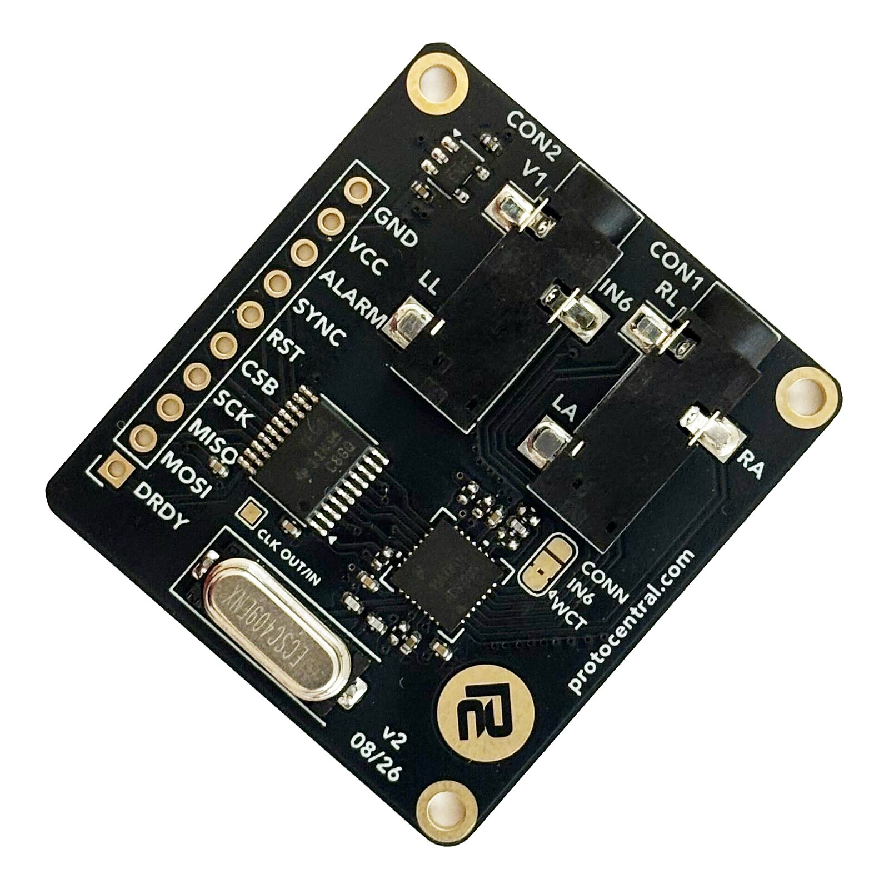

# ProtoCentral ADS1293 Breakout — Hardware

Open-source hardware design files for the **ProtoCentral ADS1293 3-Channel, 24-bit ECG Breakout** — a multi-lead ECG analog front end based on the [Texas Instruments ADS1293](https://www.ti.com/product/ADS1293).

The ADS1293 integrates three simultaneously sampled, 24-bit ECG channels and a fourth analog channel for pace-pulse detection, at 0.3 mW per channel. Right-leg drive, Wilson Central Terminal generation and lead-off detection are all on-chip, so the board carries no discrete instrumentation-amplifier or filter chain — you get a complete ECG signal path over SPI. Two 3.5 mm jacks accept the standard snap-lead electrode cables, and the board runs from either 3.3 V or 5 V on both supply and logic with no jumpers to set.

## Don't have one? [Buy it here](https://protocentral.com/product/protocentral-ads1293-breakout-board/)

## Links

| | |
|---|---|
| 🛒 Product page | https://protocentral.com/product/protocentral-ads1293-breakout-board/ |
| 💻 Arduino library | https://github.com/Protocentral/protocentral-ads1293-arduino |
| 📄 IC datasheet (TI) | https://www.ti.com/lit/ds/symlink/ads1293.pdf |

## Specifications

- **AFE:** Texas Instruments ADS1293 — 3-channel, 24-bit ECG analog front end
- **Channels:** three simultaneously sampled 24-bit ECG channels, plus a fourth analog channel for pace-pulse detection
- **Power:** 0.3 mW per channel
- **On-chip:** right-leg drive amplifier, Wilson Central Terminal generation, AC and DC lead-off detection
- **Electrode inputs:** RA, LA, LL, RL, V1 and IN6, brought out across the two 3.5 mm jacks and silkscreened beside each jack contact
- **Clock:** onboard 4.096 MHz crystal (ECS-41-18-5PXEN); `CLK OUT/IN` test pad for driving several boards from one clock
- **Interface:** SPI, via a TXB0108 8-bit bidirectional level translator
- **Connectors:** 2× 3.5 mm TRS electrode jacks (CON1, CON2), 0.1″ 1×10 header
- **Supply:** 3.3 V – 5 V on VCC and on logic — no jumper selection; an onboard Toshiba TCR2EF33 LDO derives the internal 3.3 V rail
- **Board:** 4× plated mounting holes

## Pinout

The 1×10 header, in silkscreen order:

| Pin | Function |
|---|---|
| GND | Ground |
| VCC | Supply, 3.3 V to 5 V |
| ALARM | Alarm / interrupt output |
| SYNC | Multi-board synchronisation |
| RST | Reset, active low |
| CSB | SPI chip select, active low |
| SCK | SPI clock |
| MISO | SPI data out |
| MOSI | SPI data in |
| DRDY | Data-ready output |

## Electrode connections

Each 3.5 mm TRS jack carries three electrode contacts:

| Jack | Tip | Ring | Sleeve |
|---|---|---|---|
| **CON1** | LA — left arm | RA — right arm | RL — right leg (driven reference) |
| **CON2** | LL — left leg | IN6 | V1 — chest |

`JP2` — silkscreened `CONN / IN6 / WCT` — ships bridged 1–2, tying the ADS1293's IN6 input to the
**Wilson Central Terminal**. Cut it and bridge 2–3 to route CON2's ring contact to IN6 instead.

## Safety

This board has **no patient isolation** and is **not a medical device**. When the subject is a person, power the host from a **battery** — never while it is connected to mains USB. This is a research, education and maker board.

## Repository layout

| Folder | Contents |
|---|---|
| [`hardware/v2/`](hardware/v2/) | Current Rev 2 KiCad project (schematic + PCB layout) and the exported [schematic PDF](hardware/v2/protocentral-ads1293-schematic.pdf) |
| [`hardware/v1/`](hardware/v1/) | Superseded Rev 1 Eagle sources, kept for reference |
| [`docs/`](docs/) | Reference material, including the ADS1293 datasheet |
| [`assets/`](assets/) | Product photography used by this README |

## Revision status

**Rev 2** (silkscreened `v2 08/26`) is the current shipping board. Changes from Rev 1:

- Supply and logic both accept 3.3 V – 5 V directly; the Rev 1 logic-level and supply-selection solder jumpers are gone.
- The header is **10 pins** and is **not pin-compatible with the 12-pin Rev 1 header**. `WCT` and `CLK` are no longer brought out to the header, and a `SYNC` pin has been added. `CS` is now labelled `CSB`.
- `CLK` moved to a `CLK OUT/IN` solder pad.
- Electrode assignments are now silkscreened next to the jack contacts they belong to.
- Four plated corner mounting holes, up from two.
- The 3.5 mm jacks moved to the top edge of the board.

The Arduino library is unchanged across the two revisions — it takes `DRDY` and `CS` as constructor arguments and uses hardware SPI, so only your wiring differs.

## License

The hardware design files in this repository are licensed under the **CERN Open Hardware Licence Version 2 – Permissive (CERN-OHL-P v2)**. See [LICENSE](LICENSE).

The accompanying Arduino library (in the separate [protocentral-ads1293-arduino](https://github.com/Protocentral/protocentral-ads1293-arduino) repository) is licensed under the MIT License.
